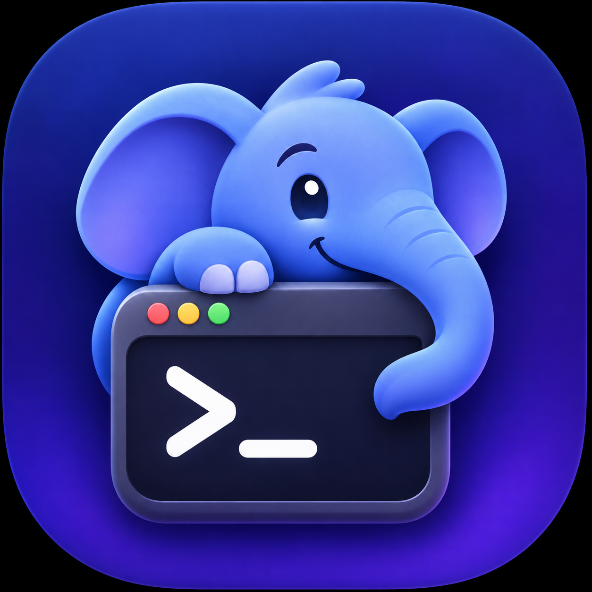

# TinkerDesk

## [English README](README.md)

<p align="center">
  
</p>

TinkerDeskは、ローカルのLaravelアプリケーションでPHPコードを実行するためのmacOSネイティブアプリです。クリーンルーム方式で開発しています。

## 初回リリースの機能

- ローカルのLaravelプロジェクトを開く際に、Composerの依存パッケージがインストールされているかを確認します。
- HomebrewまたはシステムのPHPを自動検出します。使用するPHPの実行ファイルは手動でも選べます。
- 同梱のPHPantom 0.11.1が、プロジェクトに応じたコード補完と、名前空間のインポートに必要な `use` 文の自動追加を行います。
- プロジェクトごとにタブが開き、複数のLaravelプロジェクトを切り替えられます。
- Laravel公式ドキュメントを参考にしたダークテーマで、PHPの構文を色分けします。
- Laravelのコンソール環境を起動し、アプリケーションの初期化が完了してからスニペットを実行します。
- 実行結果には、出力、戻り値、PHPとLaravelのバージョン、実行時間、発生した例外やエラーの詳細が表示されます。
- `Command-R` または `Command-Enter` で実行し、`Esc` で強制終了できます。実行に失敗しても、編集中のコードは残ります。
- 開いているタブ、プロジェクトごとのスニペット、選択したPHPの実行ファイルのパスをローカルに保存します。

## macOSで初めて起動するとき

1. [TinkerDeskのリリースページ](https://github.com/askdkc/tinkerdesk/releases)からZIPファイルをダウンロードし、展開して `TinkerDesk.app` を開きます。
2. 開発元を確認できないという警告が出たら、いったん閉じます。「システム設定」→「プライバシーとセキュリティ」を開き、「セキュリティ」までスクロールします。
3. TinkerDeskに関するメッセージの横にある「このまま開く」をクリックし、確認画面で起動を許可します。次回からは通常どおり開けます。

## ビルド

```sh
./Scripts/package-app.sh
```

ビルドが終わったら、`dist` ディレクトリの `TinkerDesk.app` を開きます。

ビルドしたアプリにはアドホック署名が付きます。配布版はAppleの公証を受けていないため、初回起動時に開発元を確認できないという警告が出る場合があります。

PHPantomはMITライセンスで同梱しています。SwiftPMは `Sources/TinkerCore/Resources/PHPantom` にあるApple Silicon用の実行ファイルとライセンスを、実行時に使うリソースバンドルにコピーします。配布用アプリでは、同じ実行ファイルを `Contents/Helpers` に、ライセンスを `Contents/Resources` に収録しています。LaravelプロジェクトにPHPantomをインストールする必要はありません。

## ライセンス

TinkerDeskはMITライセンスで配布しています。Copyright © 2026 dkc.

## スニペットの書き方

`php artisan tinker` に入力するときと同じようにPHPコードを書きます。先頭の `<?php` タグは省略できます。

アプリケーションの `Models` 名前空間にあるクラスは、`User::query()` のようにモデル名だけで参照できます。PHPantomが利用できない場合も、`app/Models` 内のモデルは補完候補に表示されます。

`Command-/` で、カーソルのある行または選択した行のコメント化と解除を切り替えられます。`Command-R` または `Command-Enter` でスニペットを実行します。途中で止めるには `Esc` を押してPHPプロセスを終了します。

```php
return [
    'name' => config('app.name'),
    'users' => App\Models\User::query()->count(),
];
```
