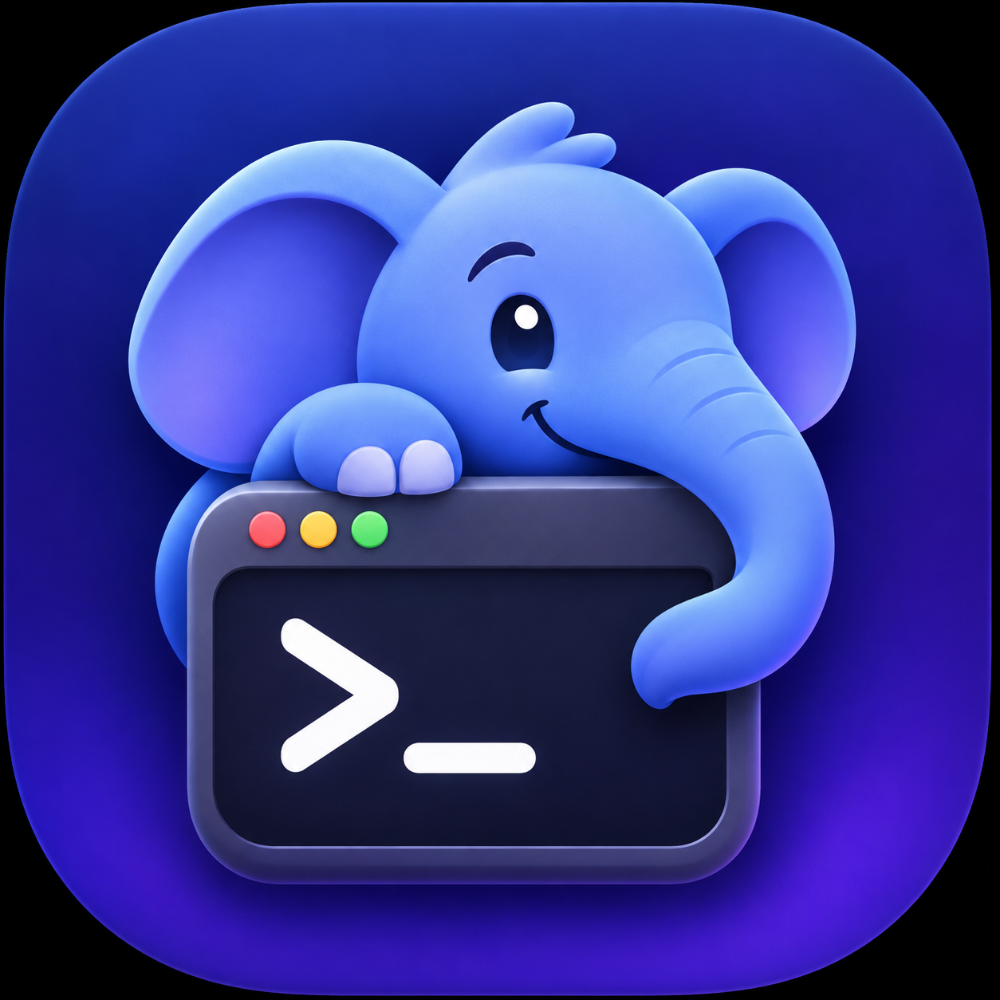

# TinkerDesk

<p align="center">
  
</p>

TinkerDesk is a clean-room native macOS workbench for running PHP inside a local Laravel application.

## Included in the first release

- Opens and validates a local Laravel project with installed Composer dependencies.
- Detects Homebrew or system PHP, with a manual PHP picker.
- Bundles PHPantom 0.11.1 for project-aware completion and automatic namespace imports.
- Opens each Laravel project in its own switchable tab.
- Highlights PHP with a Laravel documentation-inspired dark palette.
- Runs snippets in a fully booted Laravel console context.
- Captures printed output, returned values, PHP/Laravel versions, timing, and throwable details.
- Runs with `Command-R` or `Command-Enter`, force-stops with `Esc`, and retains the editor contents after failures.
- Persists open project tabs, per-project snippets, and the PHP executable locally.

## First launch on macOS

1. Download the ZIP from [TinkerDesk Releases](https://github.com/askdkc/tinkerdesk/releases), unzip it, and open `TinkerDesk.app`.
2. If macOS says it cannot verify the developer, dismiss the alert. Open **System Settings → Privacy & Security** and scroll to **Security**.
3. Find the message about TinkerDesk and click **Open Anyway**. Confirm when prompted. After this first launch, you can open TinkerDesk normally.

## Build

```
./Scripts/package-app.sh
```

Open `TinkerDesk.app` in the `dist` directory.

The generated app is ad-hoc signed. The downloadable build is not notarized, so macOS may show the developer verification alert on first launch.

PHPantom is bundled under its MIT license. SwiftPM copies the Apple Silicon executable and license from `Sources/TinkerCore/Resources/PHPantom` into its runtime resource bundle. The packaged app ships the same executable in `Contents/Helpers` and its license in `Contents/Resources`. Laravel projects need no PHPantom installation.

## License

TinkerDesk is available under the MIT License. Copyright © 2026 dkc.

## Snippet format

Write the body you would normally enter in `php artisan tinker`; the `<?php` tag is optional.
Use model names such as `User::query()` directly for classes in the application’s `Models` namespace. If PHPantom is unavailable, the editor still offers completions for models in `app/Models`.
Press `Command-/` to toggle line comments on the current line or the selected lines.
Press `Command-R` or `Command-Enter` to run it. While it is running, press `Esc` to terminate the PHP process.

```php
return [
    'name' => config('app.name'),
    'users' => App\Models\User::query()->count(),
];
```
